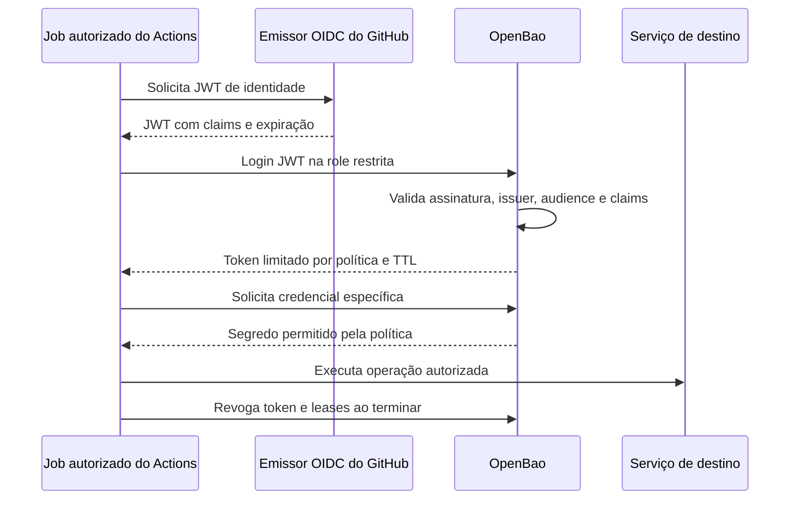

# Secrets, Variables e OpenBao

O objetivo é escolher onde cada configuração deve ficar, controlar quem a utiliza e reduzir a duração das credenciais. O catálogo é uma aplicação de navegador: nenhuma credencial de produção precisa entrar no seu build. O laboratório usa apenas um valor artificial.

## Escolher o mecanismo

| Informação | Mecanismo | Exemplo |
| --- | --- | --- |
| Configuração sem conteúdo sensível | GitHub Variables (`vars`) | `APP_STAGE`, região, endereço público do vault |
| Credencial pontual necessária ao workflow | GitHub Secrets (`secrets`), no menor escopo possível | Token restrito de uma integração sem suporte a identidade federada |
| Credencial de produção ou compartilhada por vários sistemas | OpenBao ou outro vault, com políticas próprias | Credencial de banco, chave de serviço |
| Acesso a serviço com federação de identidade | OIDC e credencial temporária | GitHub Actions autenticando no vault ou provedor de nuvem |
| Acesso à API do próprio repositório | `GITHUB_TOKEN` com permissões explícitas | Leitura de conteúdo durante checkout |

Variables não têm a proteção de Secrets e não devem guardar senhas. `env` é o mecanismo para entregar um valor ao processo; pode receber tanto uma variável comum quanto um segredo. Usar `env` não torna um valor secreto. [GitHub Variables](https://docs.github.com/en/actions/how-tos/write-workflows/choose-what-workflows-do/use-variables).

Secrets podem ter escopo de organização, repositório ou environment. Restrinja quais repositórios acessam os secrets organizacionais; separe homologação e produção com environments. Um secret de environment fica disponível ao job que referencia esse environment, após suas regras de proteção. Não dependa apenas de nomes diferentes para criar isolamento. [GitHub Secrets](https://docs.github.com/en/actions/how-tos/write-workflows/choose-what-workflows-do/use-secrets).

## Por que não concentrar todos os segredos no GitHub

**Não concentre todas as credenciais permanentes e de alto privilégio no GitHub.** Um comprometimento de conta, workflow, runner ou Action pode ampliar muito o impacto quando o mesmo ambiente tem acesso a todos os sistemas. Recomenda-se combinar GitHub com OpenBao ou outro vault, separando administração, políticas e auditoria, e buscar somente a credencial necessária ao job.

Há incidentes documentados no ecossistema. Em março de 2025, o comprometimento de `tj-actions/changed-files` levou à exposição de segredos em logs de workflows. Esse caso é um ataque à cadeia de fornecimento de Actions; não é evidência de que o armazenamento criptografado de GitHub Secrets foi invadido. Evite a afirmação genérica de que o GitHub sofre “constantes brechas” sem identificar incidente, vetor e evidência. [Alerta do NHS England](https://digital.nhs.uk/cyber-alerts/2025/cc-4632).

O GitHub protege secrets armazenados, mas seu valor precisa ser disponibilizado ao processo autorizado que os utiliza. Uma Action maliciosa ou código comprometido nesse contexto pode capturá-los. Mascaramento de logs não impede exfiltração pela rede e pode falhar para valores transformados. [Orientações de segurança do GitHub](https://docs.github.com/en/actions/reference/security/secure-use).

Um vault reduz centralização no CI e oferece controles próprios; ele também exige atualizações, TLS, backups, controle de administradores e auditoria. Se o job comprometido ainda puder ler todos os segredos do vault, a separação não atingiu seu objetivo. Evite trocar dezenas de secrets por um token root permanente do OpenBao guardado no GitHub.

## Laboratório: configurar Secrets e Variables

1. No repositório da turma, abra **Settings → Environments** e crie `laboratorio`. Restrinja as branches autorizadas a `main`. Configure aprovação e impedimento de autoaprovação quando o plano oferecer essas opções; peça a um colega para revisar a execução.
2. Nesse environment, crie a Variable `APP_STAGE` com valor `aula` e o Secret `DEMO_TOKEN` com um texto artificial criado para o exercício. Não reutilize uma credencial real.
3. Publique o workflow `laboratorio-secrets.yml`. No monorepo, sua versão ativa está na `.github/workflows` da raiz. Para uso independente, já existe uma cópia nesta pasta.
4. Em **Actions → Laboratório - Secrets e Variables → Run workflow**, escolha `main`. Observe a eventual espera por aprovação e o resultado.
5. O passo recebe `${{ vars.APP_STAGE }}` e `${{ secrets.DEMO_TOKEN }}` pelo `env`. A variável é exibida; o segredo é apenas validado como presente. Não imprima seu conteúdo, nem codificado, nem seu hash.
6. Remova temporariamente `DEMO_TOKEN` e execute novamente: o passo deve falhar com mensagem de configuração ausente. Recrie o valor artificial e confirme a aprovação.
7. Troque o valor do Secret e execute novamente. Essa troca demonstra atualização do armazenamento; uma rotação real também exige invalidar a credencial anterior no sistema emissor.

O workflow é manual, só aceita execução em `main`, não faz checkout, não instala pacotes e não precisa de permissões de API. A referência ao environment no YAML não configura suas proteções; faça a configuração antes do exercício. Não torne este laboratório um check obrigatório de merge.

Nunca coloque segredos em `VITE_*`: o Vite pode incorporá-los ao JavaScript público. Um segredo de runtime deve ser consumido por um backend ou serviço autorizado. Não envie segredos para artefatos, caches, outputs de jobs, capturas de tela ou relatórios de aula.

## Combinar GitHub Actions com OpenBao

OpenBao é um gerenciador de segredos que pode autenticar identidades, aplicar políticas de acesso e registrar operações em dispositivos de auditoria configurados. É uma alternativa para compor a gestão com GitHub, assim como HashiCorp Vault e serviços gerenciados de segredos.



No Actions, `id-token: write` permite solicitar a identidade OIDC; não concede por si só acesso ao OpenBao. O vault decide se confia nela. Use `role_type: jwt` no método JWT do OpenBao; o fluxo de máquina não exige login interativo em navegador. [OIDC do GitHub](https://docs.github.com/en/actions/reference/security/oidc), [JWT no OpenBao](https://openbao.org/docs/auth/jwt/).

### Preparação pelo administrador do vault

Em um ambiente isolado de aula, com TLS válido e endereço alcançável pelo runner:

1. Habilitar KV v2 em `secret/` e criar **somente um valor artificial** em `secret/ci/laboratorio`. Não usar servidor em modo dev para produção.
2. Habilitar o método JWT em `auth/github` e configurar `oidc_discovery_url` e `bound_issuer` como `https://token.actions.githubusercontent.com`.
3. Criar uma policy que permita apenas `read` em `secret/data/ci/laboratorio`. Não conceder listagem global, escrita, acesso root ou administração de policies.
4. Criar uma role JWT com `bound_audiences` igual à audiência escolhida para o laboratório, por exemplo `openbao-laboratorio`, e vincular a policy. Definir TTL curto, por exemplo cinco minutos, e limite máximo compatível.
5. Restringir os claims ao repositório esperado, preferindo também `repository_id` e `repository_owner_id` para identificar seu proprietário e repositório. Validar a branch `ref: refs/heads/main` e o environment esperado. Os valores e a forma das condições devem corresponder ao JWT emitido no repositório de aula.
6. Habilitar auditoria e verificar negações de acesso. Manter administração do vault separada das permissões de contribuição no repositório.

Não use apenas `iss` ou uma audiência genérica como condição de confiança: isso permitiria identidades de outros repositórios. O formato de `sub` pode variar com o environment e a configuração de subject do GitHub; use a referência atual de claims para configurar o vínculo. Um job com environment normalmente usa um subject de environment, em vez do subject de branch; valide `ref` separadamente.

### Esqueleto de job para discussão

Este trecho é um roteiro de integração, não um deploy pronto. Não foi ativado um acesso externo nem provisionado um vault nesta aula.

```yaml
permissions: {}
jobs:
  operacao:
    if: github.ref == 'refs/heads/main'
    environment: laboratorio
    runs-on: ubuntu-latest
    permissions:
      id-token: write
    steps:
      - name: Autenticar e consumir segredo no mesmo processo
        env:
          BAO_ADDR: ${{ vars.BAO_ADDR }}
          BAO_ROLE: ${{ vars.BAO_ROLE }}
          BAO_AUDIENCE: openbao-laboratorio
        run: |
          # Implementar com cliente HTTP/SDK revisado:
          # 1. Solicitar JWT pela API OIDC do runner, com a audience acima.
          # 2. POST /v1/auth/github/login com role e jwt.
          # 3. Ler /v1/secret/data/ci/laboratorio com o token retornado.
          # 4. Consumir o valor no mesmo processo, sem imprimir ou persistir.
          # 5. Revogar token com /v1/auth/token/revoke-self em bloco finally.
          # Não registrar corpos das respostas ou headers de autenticação.
          echo "Roteiro ilustrativo: implementar após configurar o vault."
```

`BAO_ADDR` e `BAO_ROLE` podem ser Variables se não forem informações sensíveis para a organização. Não há `BAO_TOKEN` permanente cadastrado no GitHub. O token OIDC e a sessão do vault também são sensíveis; não decodifique nem publique seus conteúdos em logs. Use cliente que valide certificados e não encaminhe autenticação para redirecionamentos arbitrários.

A policy do exemplo lê um **segredo estático KV**. O TTL do token limita por quanto tempo o job pode consultar o vault, mas não faz o valor KV expirar nem invalida uma cópia roubada. Para credenciais temporárias reais, use um secrets engine dinâmico suportado pelo sistema de destino, com leases e revogação; para valores estáticos, defina rotação no emissor. [Leases e limites de KV](https://openbao.org/docs/concepts/lease/).

Mesmo com OIDC, um atacante com controle sobre um job autorizado pode usar a identidade durante sua validade. Por isso, combine a federação com revisão de workflows, proteção do environment, política mínima e runners confiáveis. Se houver cancelamento abrupto, a limpeza pode não executar; TTL e expiração são necessários além da revogação ao final.

## Evidências e resposta a incidente

Entregue a classificação de cinco configurações, evidências do laboratório sem valores secretos, um desenho da política de confiança do vault e uma explicação da diferença entre expiração do token e rotação do segredo.

Se houver vazamento real: revogue ou rotacione no emissor, interrompa workflows suspeitos, investigue acessos e preserve evidências com acesso restrito. Remova exposições em logs e artefatos e trate o histórico Git. Excluir uma linha ou atualizar apenas o GitHub Secret não invalida a credencial vazada.
